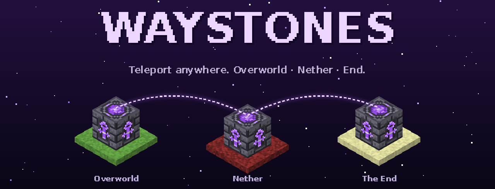
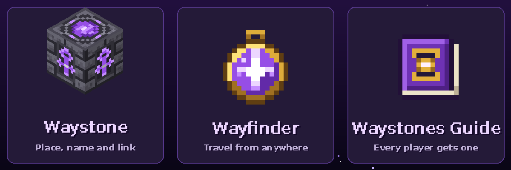
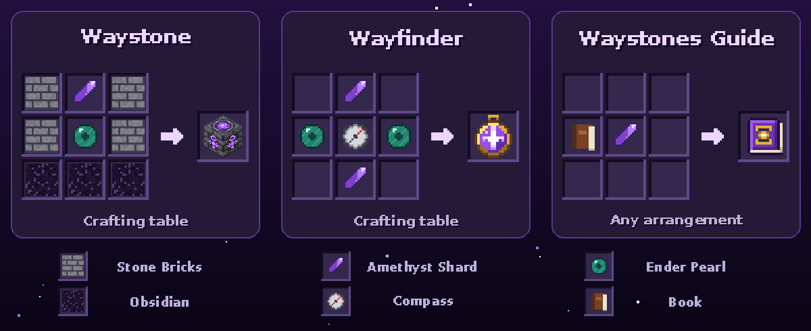
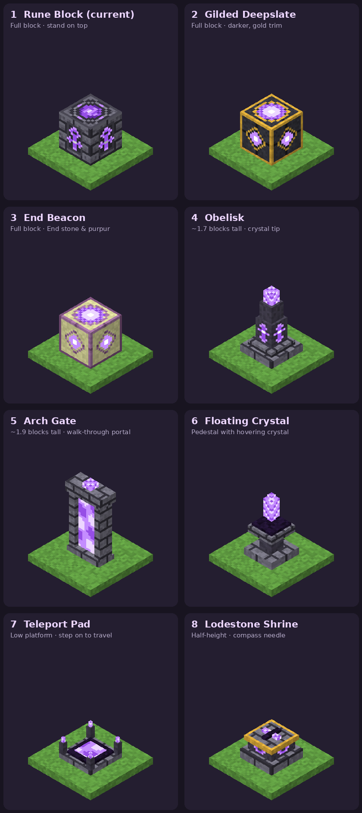

<p align="center">
  
</p>

<p align="center">
  <a href="https://github.com/sculley/waystones/releases/latest"></a>
  <a href="https://github.com/sculley/waystones/actions/workflows/release.yml"></a>
  
  
</p>

**Waystones** is a lightweight Minecraft Bedrock add-on for fast travel. Place a waystone, give it a name, and link it to others — then teleport between them at any distance, across the Overworld, the Nether and the End. Carry a **Wayfinder** to jump to any waystone from wherever you are.

No experimental toggles. Works on every Bedrock platform, including console via Realms.

<p align="center">
  
</p>

## ⬇️ Download

Grab **`Waystones-x.y.z.mcaddon`** from the [latest release](https://github.com/sculley/waystones/releases/latest).

## ✨ Features

- **Waystones** — craft, place and name them. Each one is **Public** (anyone can use it) or **Private** (only you).
- **Link one-to-one or one-to-many** — a waystone with a single link works like a portal pair; one with several links shows a destination list. Links are two-way.
- **Wayfinder** — use it anywhere to travel to any waystone you can access, nearest first.
- **Any distance, any dimension** — Overworld ↔ Nether ↔ End, no range limit.
- **Safe arrivals** — blocks can't be placed in the two spaces above a waystone. If something still ends up there (snow, falling sand), you arrive next to it; if the waystone was destroyed, you're returned to where you started.
- **Waystones Guide** — every player gets one on first join; it explains everything in-game.
- **Blast-proof** — waystones are as explosion-resistant as obsidian.

## 🎮 How to play

| Action | How |
|---|---|
| Place & name a waystone | Place it — a naming screen opens. |
| Link waystones | **Sneak + use** your waystone → **Manage** → **Link waystones**, tick destinations. |
| Travel (one link) | Use the waystone. |
| Travel (several links) | Use the waystone and pick a destination. |
| Travel from anywhere | Hold the **Wayfinder** and press use. |
| Rename / make private | Sneak + use → **Manage** → **Rename & privacy**. |

There's a 3-second recharge between trips.

## 🛠️ Recipes

All crafted on a crafting table. Everything is also in the creative inventory, and the recipes are in the Waystones Guide in-game.

<p align="center">
  
</p>

## 📦 Installing

### Windows / Android / iOS
1. Download the `.mcaddon` and open it — Minecraft imports both packs.
2. Create or edit a world → **Behavior Packs** → activate **Waystones**. The resource pack is added automatically.

### PS5, Xbox and Switch
Consoles can't import add-on files directly, so bring the add-on in with a world:
1. Import the `.mcaddon` on a phone, tablet or PC and create a world with it active.
2. Upload that world to your **Realm** (Realm settings → *Replace world*).
3. Join the Realm from your console — the packs download automatically.

You can also host the world on a phone or PC and join it from your console as a friend.

> Like all add-ons, Waystones turns off achievements for the world it's enabled in.

## 🧪 Design explorations

Alternative waystone styles being considered for future versions — **not in the game yet**.

<p align="center">
  
</p>

## 🧑‍💻 Development

```
Waystones_BP/              behaviour pack
  blocks/ items/ recipes/  block, item and recipe definitions
  scripts/main.js          wires custom components and events
  scripts/store.js         waystone storage (one world dynamic property each)
  scripts/teleport.js      travel, cooldown, arrival checks, effects
  scripts/ui.js            menus
  scripts/guide.js         the guide book and first-join gift
Waystones_RP/              resource pack — textures, names, icon
  font/glyph_E5.png        recipe icons used as text glyphs in the guide
tools/                     build script and artwork generators
docs/images/               README artwork
```

Built on the stable Script API — `@minecraft/server` 2.0.0 and `@minecraft/server-ui` 2.0.0 — using custom components (V2).

**Build locally**

```bash
python tools/build.py          # → dist/Waystones-<manifest version>.mcaddon
python tools/build.py 1.2.0    # stamp a specific version into the package
```

**Regenerate artwork** (needs Pillow and the DejaVu fonts)

```bash
python tools/make_textures.py                         # pack textures and icons
cd tools && python render_docs.py && python render_recipes.py && python render_concepts.py   # README images + guide glyphs
```

**Release** — push a version tag and GitHub Actions validates the packs, builds the `.mcaddon` and `.mcpack` files, and attaches them to a new release:

```bash
git tag v1.2.0
git push origin v1.2.0
```

Every push and pull request is also built, with the files available as a workflow artifact.

---

<sub>All textures and artwork are original and generated by the scripts in <code>tools/</code>. Not affiliated with Mojang or Microsoft.</sub>
