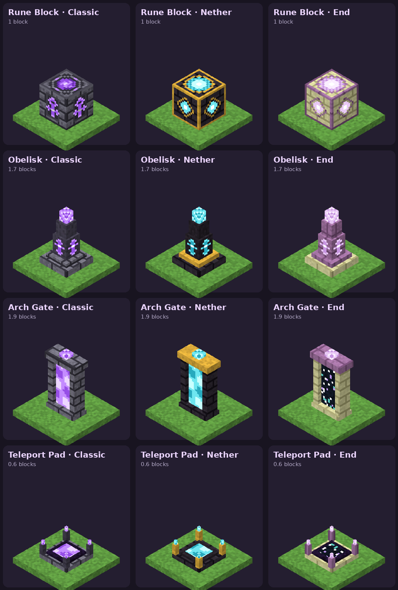

# Waystone styles — design spec

Status: **proposal** · Sheet: [`images/styles.png`](images/styles.png) · Drawn by `tools/render_styles.py`

Four shapes × three themes = 12 waystones. Every one is a full waystone: it can be named, appears in the travel menu, and links into the same network as all the others. Style is cosmetic, plus where you arrive.

## 1. Themes

The same three themes run across every shape so each family reads as a set.

| Theme | Main material | Core / accent | Trim | Glow colour | Portal surface |
|---|---|---|---|---|---|
| **Classic** | Stone bricks | Dark stone | Stone bricks | Amethyst purple `#9C4EE6` | Purple swirl |
| **Nether** | Polished blackstone bricks | Blackstone | Gold | Soul-fire cyan `#6EE6F0` | Cyan swirl |
| **End** | End stone bricks | Purpur | Purpur pillar | Pale violet `#E8C8F5` | Starfield (like an End gateway) |

## 2. Shapes

Sizes are in pixels (16 px = 1 block). All shapes sit on a single block's footprint.

| Shape | Size (W × H × D) | Parts | Arrive | Collision | Light |
|---|---|---|---|---|---|
| **Rune Block** | 16 × 16 × 16 (1 block) | Single cube, emblem on top and sides | On top (as now) | Full block | 7 |
| **Obelisk** | 16 × 27 × 16 (1.7 blocks) | Base slab 3 px → trim step 2 px → rune shaft 10 px → upper shaft 7 px → crystal tip 5 px | 1 block in front, facing away | Bottom block only, 12 × 16 × 12 | 10 |
| **Arch Gate** | 18 × 30 × 8 (1.9 blocks) | Plinth 2 px, two 3 px pillars, lintel 3 px, keystone crystal 2 px, portal panel 10 × 23 px | 1 block in front, facing away (as if you stepped out of it) | None (walk-through) | 12 |
| **Teleport Pad** | 16 × 9 × 16 (0.6 blocks) | Base 2 px, inset floor 1 px, portal surface, four 5 px corner posts with crystal tips | Centre of the pad | 16 × 3 × 16 | 6 |

Variant-specific details:

- **Rune Block · Classic** is today's `wst:waystone`, unchanged.
- **Rune Block · Nether / End** use the framed-emblem layout: a 1 px frame (gold / purpur), glowing ring and core on top, diamond emblem on each side.
- **Teleport Pad · Nether** uses gold corner posts; Classic and End use the core material.
- **Arch Gate · Nether** lintel is gold; Classic and End use their trim.

## 3. Block IDs and names

| | Classic | Nether | End |
|---|---|---|---|
| Rune Block | `wst:waystone` (existing) | `wst:waystone_nether` | `wst:waystone_end` |
| Obelisk | `wst:obelisk` | `wst:obelisk_nether` | `wst:obelisk_end` |
| Arch Gate | `wst:arch` | `wst:arch_nether` | `wst:arch_end` |
| Teleport Pad | `wst:pad` | `wst:pad_nether` | `wst:pad_end` |

Display names follow "<Theme> <Shape>", e.g. *Nether Obelisk*; Classic drops the prefix (*Waystone*, *Obelisk*, *Arch Gate*, *Teleport Pad*).

## 4. Crafting

Three crafting-table recipes make a Rune Block of each theme. A **stonecutter** then turns a Rune Block into any shape of the same theme, 1:1, and back again, so players can restyle without losing anything.

| Theme | Pattern | Key |
|---|---|---|
| Classic (existing) | `SAS` / `SES` / `OOO` | S stone bricks · A amethyst shard · E ender pearl · O obsidian |
| Nether | `BGB` / `BEB` / `CCC` | B polished blackstone bricks · G gold ingot · E ender pearl · C crying obsidian |
| End | `SPS` / `SES` / `OOO` | S end stone bricks · P popped chorus fruit · E ender pearl · O obsidian |

Stonecutter recipes: 9 shape conversions (Rune Block → Obelisk / Arch / Pad per theme) + 9 back to the Rune Block = 18 small `recipe_shapeless` files tagged `stonecutter`.

## 5. Building it in Bedrock

- **One geometry file per shape** (4 `.geo.json` files). Each model's bones use named material slots (`base`, `core`, `trim`, `glow`, `portal`). Each block variant then maps those slots to its theme's textures in `minecraft:material_instances`, so the 12 blocks share 4 models.
- **Glow parts** use `face_dimming: false` and `ambient_occlusion: false` so they look lit. Bedrock has no per-pixel emissive for blocks, so this plus `minecraft:light_emission` is how the glow is faked.
- **Portal surfaces** can be animated with `flipbook_textures.json` (a slow 8-frame swirl, or twinkling stars for End).
- **Facing:** Obelisk and Arch Gate need the `minecraft:placement_direction` trait (`cardinal_direction`) plus a rotation `minecraft:transformation` per direction, so they face the player who placed them. Rune Block and Pad don't need this.
- **Size limit:** Bedrock caps a block model at 30 px in each direction. The Arch Gate is exactly 30 px tall and the Obelisk 27 px, so both fit. Neither may grow taller.
- **Space above:** the Obelisk and Arch draw into the block above but don't own it. Recommended: on placement, require the block above to be air and place an invisible `wst:waystone_top` filler there (no texture, blocks building into the model, breaking it breaks the waystone). Optional for a first version.
- **Arch collision:** a block has one collision box, which can't leave a doorway, so the Arch has none and you can walk through the pillars. Acceptable for a decorative gate.

## 6. Script changes

- **Recognise every variant.** `main.js` and `teleport.js` compare `block.typeId` to `wst:waystone`. Switch to a block tag (`"tag:wst_waystone": {}` on all 12 blocks, then `block.hasTag("wst_waystone")`). All 12 already carry the `wst:waystone` custom component, so the interaction handler needs no change.
- **Arrival point per shape.** Store the shape and facing with each waystone, then: Rune Block → `y + 1` on top; Pad → centre at `y + 3/16`; Obelisk and Arch → the block in front, rotated to face away.
- **Blocked check** should test the 2 blocks at the arrival spot, not always the 2 above the waystone.
- **Restyling.** Breaking a waystone drops its own variant. Placing it again creates a new waystone (as today), so the old name and links don't carry over.

## 7. Open questions

1. Should walking into an Arch Gate or stepping on a Pad open the travel menu automatically, or keep it on interact like the Rune Block?
2. Should the theme be purely cosmetic, or limited to its dimension (e.g. Nether styles only craftable from Nether materials, but placeable anywhere)? The recipes above already lean on dimension materials without restricting placement.
3. Build all 12 at once, or ship one shape (all three themes) per release?
